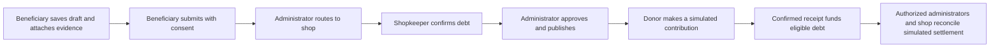

# [Ktab-L7anout](https://github.com/mokhtarsoumair399-collab/Ktab-L7anout)

<div dir="rtl">

## ما هو مشروع Ktab-L7anout؟

Ktab-L7anout منصة تضامن غذائي في المغرب تساعد الأسر التي تواجه صعوبات مالية على تسوية ديون مشترياتها الأساسية لدى بقالات الأحياء (مول الحانوت). تبدأ العملية بطلب مساعدة، ثم يؤكد البقال المعني وجود الدين ومبلغه، وتراجع الإدارة الملف قبل الموافقة على نشره. يستطيع المتبرع المساهمة في ملف منشور أو دعم صندوق الديون المستعجلة. تُسدَّد المبالغ للبقالة الموثّقة، وتستفيد الأسرة من تخفيض الدين أو تسويته.

تدعم المنصة العربية بتخطيط من اليمين إلى اليسار والفرنسية، وتنظّم الطلبات حسب الجهات المغربية والمدن والجماعات المسجّلة. تظهر المبالغ بالدرهم المغربي وتُحفظ في النظام بالسنتيمات الصحيحة حتى تبقى الحسابات دقيقة.

### من يستخدم المنصة؟

- **الأسرة المستفيدة** تختار المدينة والبقالة، وتدخل مبلغ الدين وتشرح وضعها المالي، وترفق إثباتاً بصيغة PDF أو صورة، وتوافق على شروط الخصوصية قبل إرسال الطلب. يمكنها متابعة حالته من حسابها.
- **البقال** يسجّل بقالته ويرفع الوثائق المطلوبة. بعد ورود طلب تحقق يخصّ بقالته، يمكنه تأكيد الدين ومبلغه، أو الاعتراض على المبلغ، أو رفض الطلب مع توضيح السبب. ويتابع التسوية ويؤكّد الاستلام أو يبلّغ عن اختلاف.
- **الإدارة** تتحقق من البقالات، وتراجع الطلبات والوثائق وتأكيدات البقالين، وتوافق على الملفات المؤهلة ثم تنشرها. ويمكنها طلب معلومات إضافية أو معالجة النزاعات، ومراجعة التبرعات والتخصيصات والتسويات، والرجوع إلى سجل التدقيق.
- **المتبرع** يتصفح الملفات المنشورة ويبحث عنها حسب الموقع والمبلغ والأولوية وحالة التمويل. يعرض الملف العام مرجعاً مجهول الهوية وموقعاً عاماً والدين المعتمد والتقدّم في تمويله. تظل وثائق الأسر الخاصة متاحة عبر صلاحيات محددة.

إذا كان الطلب قيد المراجعة أو معلّماً للمراجعة الإضافية، فلن يظهر في قائمة التبرّع. يظهر للمتبرعين بعد تأكيد الدين، وموافقة الإدارة، ونشر الملف. وعند البحث عن ملف منشور، تُدخل حدود المبلغ في صفحة الاستكشاف بالدرهم. إذا كانت قيمة الدين المعتمد 1000 سنتيم، فهي 10 دراهم، ولذلك يستبعدها مرشح يبدأ من 20 درهماً.

## كيف تتم عملية التبرّع؟

### المساهمة في ملف محدد عبر واتساب

1. سجّل الدخول بحساب متبرع وافتح ملفاً منشوراً متاحاً للتمويل. اختر مبلغاً مقترحاً أو أدخل مبلغاً خاصاً بالدرهم في حدود الرصيد المتبقي. يقبل النموذج الأرقام العربية مثل **١٢٫٥٠**.
2. اضغط على زر إرسال رسالة واتساب إلى البقالة. تفتح المحادثة على رقمها المهني مع رسالة جاهزة بلغة الواجهة تتضمن المبلغ ومرجع الملف. أرسل الرسالة من تطبيق واتساب.
3. ارجع إلى المنصة واضغط على زر تسجيل وعد المساهمة بعد الإرسال. يظهر المبلغ في سجل تبرعاتك بصفة «مساهمة موعودة». تعتمد المنصة على تصريحك بالإرسال، لأن رابط واتساب لا يرسل إليها تأكيداً بالتسليم.
4. افتح تفاصيل المساهمة في سجل التبرعات وشارك **مرجع المساهمة** مع البقال ليطابق الدفعة مع الوعد الصحيح. يظل الرصيد على حاله حتى يتأكد استلام الدفعة.
5. بعد استلام الدفعة خارج المنصة، يفتح البقال **مساحتي ← التسويات ← المدفوعات المستلمة خارج المنصة**، ويختار المساهمة، ويُدخل المبلغ المستلم ومرجع الدفع ويرفع إثباتاً بصيغة PDF أو صورة. عند الضغط على **«تأكيد استلام الدفع»** يُخصم المبلغ مباشرة دون انتظار موافقة إدارية. تُسجّل الدفعة في سجل مستقل عن الأموال التي تستلمها المنصة.
6. راجع تفاصيل المساهمة للاطلاع على حالة الاستلام والمبلغ الذي أكّده البقال. مثلاً، يبقى رصيد دين قدره **35 درهماً** كما هو عند تسجيل وعد بمبلغ **12,50 درهماً**. بعد تأكيد استلام **12,50 درهماً** يصبح الرصيد **22,50 درهماً**.

### صندوق الديون المستعجلة والدفع التجريبي

- يساهم المتبرع في صندوق مخصص للملفات المؤهلة، ويمكن توزيع المبلغ المؤكّد على ملف واحد أو عدة ملفات حسب الأولوية والرصيد المطلوب لكل ملف.
- تتيح المحاكاة في البيئات المهيأة لذلك اختبار نجاح الدفع أو تعليقه أو فشله أو إلغائه والاسترداد، دون بيانات بطاقات أو تحويل فعلي. يمنع النظام احتساب إشعار تأكيد مكرر.
- يُعاد الفائض في التبرّع المخصص لملف بعينه وفق السياسة المعروضة قبل الدفع. ويُدرج رصيد الصندوق غير المخصص للاسترداد بعد 30 يوماً من تأكيد الاستلام.
- يبيّن سجل التبرعات حالة الدفع والمبالغ المخصصة لكل ملف والاستردادات والتقدم في تسوية الدين لدى البقالة.

### كيف يحدّد الصندوق أولوية الملفات؟

يحسب النظام الأولوية من أربعة عوامل ذات أوزان قابلة للضبط. الأوزان المعتمدة مبدئياً هي هشاشة وضع الأسرة **35٪**، وعمر الدين **25٪**، وخطر فقدان الوصول إلى المواد الغذائية الأساسية **25٪**، والمبلغ المتبقي **15٪**. عند تعادل النقاط، يُقدّم الدين الأقدم، ثم الملف المنشور أولاً، ثم يُستخدم المعرّف الداخلي للملف لحسم التعادل. تحدّد الدرجة ترتيب تمويل الملفات المؤهلة، وتبقى قرارات القبول والرفض ضمن المراجعة البشرية.

### متى تُعدّ البقالة قد استلمت المبلغ؟

في **مسار الدفع خارج المنصة**، يؤكد البقال الاستلام بعد إضافة الإثبات، ويصبح الملف مسوّى إذا غطّت الدفعات كامل الدين. في **مسار التسوية عبر المنصة**، تبدأ التسوية بعد اكتمال تخصيص الأموال. تسجّل الإدارة مرجع التحويل وإثباته، ويؤكد البقال الاستلام أو يعترض، ثم تُطابق الإدارة السجلات قبل اعتبار الدين مسوّى.

| الحالة | ما تعنيه |
| --- | --- |
| مساهمة موعودة | سُجّل المبلغ الذي ينوي المتبرع دفعه. لم يُخصم من رصيد الدين بعد. |
| تم تأكيد الاستلام | أكد البقال دفعة خارج المنصة وأرفق إثباتاً. خُصم المبلغ من الرصيد، وقد يبقى جزء من الدين. |
| ممول بالكامل | المبالغ المخصصة تغطي الرصيد المطلوب، وقد تكون تسوية الدفعة عبر المنصة قيد التنفيذ. |
| مسوّى | سُدّد كامل الدين للبقالة وفق مسار الدفع المستخدم. |

يمكن العثور على الملفات الممولة أو المسوّاة من **الملفات المنشورة ← حالة التمويل**. وتعرض لوحة الشفافية مبالغ المنصة المستلمة والمخصصة والتحويلات المسجلة والمبالغ التي أكّدت البقالات استلامها، كلّاً على حدة.

### كيف بُني المشروع؟

- **الواجهة** مبنية باستخدام React وTypeScript وVite وTailwind CSS، وتضم صفحات عامة ومساحات مخصصة لكل دور.
- **الخادم** يوفّر واجهة REST باستخدام Laravel وSanctum، ويتحقق من المدخلات والصلاحيات على مستوى كل مورد.
- **قاعدة البيانات** تستخدم PostgreSQL. تُنفّذ العمليات المالية داخل معاملات تحمي الأرصدة من التخصيص المكرر أو تجاوز سقف الدين، وتُسجّل التعديلات المالية مع الإبقاء على تاريخ العمليات.

## خصائص المنصة

| المجال | الخصائص |
| --- | --- |
| الحسابات والصلاحيات | التسجيل حسب الدور، تسجيل الدخول والخروج، تعديل الملف الشخصي، رقم الهاتف، استعادة كلمة المرور، التحقق من البريد الإلكتروني وإدارة حالة الحساب. تُنشأ حسابات المديرين عبر إجراء إداري مخصّص. |
| الجهات والمدن | مرجع قابل للإدارة للجهات المغربية الاثنتي عشرة والمدن والجماعات المدعومة بالعربية والفرنسية. تُعرض المدن وفق الجهة المختارة، ويُربط كل متجر ودين بموقعه. |
| واجهة الزوّار | صفحة رئيسية تعرض أثر المنصة والملفات الحديثة والمستعجلة، وقائمة ملفات بصفحات متتالية مع البحث والتصفية حسب الجهة والمدينة والمبلغ والاستعجال وحالة التمويل. تعرض صفحة الملف المبلغ المعتمد والرصيد المتبقي والتقدّم والتحديثات المتاحة. |
| طلبات الأسر | إنشاء مسودة وتعديلها، تحديد البقالة والدين ووضع الأسرة، رفع PDF أو صورة، تسجيل الموافقة على الخصوصية وتتبع مراحل الطلب. يمكن إرسال الطلب بعد رفع المستند دون انتظار تحليله، إذا استوفى بقية الشروط. |
| مساحة البقال | تسجيل البقالة وإدارة بياناتها ووثائقها، استقبال الطلبات المرتبطة بها، تأكيد الدين أو رفضه أو الاعتراض على مبلغه، إرفاق إثبات، ومتابعة التسوية وتأكيد الاستلام أو الاعتراض عليها. |
| مراجعة الإدارة | التحقق من البقالات ورفضها أو تعليقها، مراجعة الإثباتات والتنبيه إلى الطلبات المحتمل تكرارها، طلب معلومات إضافية، اعتماد الملفات ونشرها أو إلغاء نشرها، ومتابعة النزاعات والحالات المعلّمة. |
| الخصوصية والوثائق | تخزين المرفقات بصورة خاصة والتنزيل وفق صلاحيات الدور والملف. يستطيع المتبرعون تنزيل النسخ المنزوعة البيانات التي تعتمد الإدارة مشاركتها من وثائق البقالة. |
| تمويل الديون | وعد مساهمة عبر واتساب لملف بعينه، وصندوق مستعجل في مسار الدفع التجريبي، وسجل للمدفوعات والتخصيصات والاستردادات. تُتابع كل مرحلة مالياً على حدة. |
| تسوية الديون | قائمة للتسويات والعمليات المتعثرة أو المتنازع عليها، ومراجعة إدارية وتسجيل مرجع التحويل والإثبات، ثم تأكيد البقال ومطابقة السجلات. |
| الشفافية والتقارير | مؤشرات عامة محسوبة من قاعدة البيانات للتمويل والتسويات والأسر المستفيدة والبقالات المشاركة والأثر حسب الجهة. تتيح الإدارة تصفية السجلات المالية وتصدير تقارير CSV ومراجعة سجل الإجراءات. |
| اللغة والأجهزة | واجهة بالعربية والفرنسية، واتجاه من اليمين إلى اليسار للغة العربية، وتنسيق مغربي للمبالغ والتواريخ، وصفحات ملائمة للهاتف والحاسوب. |
| التشغيل والحماية | فصل الواجهة عن الخادم، وتطبيق الصلاحيات والتحقق من المدخلات، وتقييد الطلبات الحساسة، وسجل مالي قابل للتدقيق. تشمل وثائق التشغيل إعدادات النشر والمهام المجدولة والمراقبة والنسخ الاحتياطي والاستعادة. |

للتشغيل على جهازك، اتبع [خطوات الإعداد المحلي](#local-setup). وللتفاصيل التقنية، راجع [بنية المشروع](docs/architecture.md) و[تصميم قاعدة البيانات](docs/database-design.md) و[قواعد التمويل والتسوية](docs/business-rules.md) و[إجراءات الحماية](docs/security.md).

</div>

Ktab-L7anout is a Moroccan food-solidarity initiative. The French and Arabic platform supports verified grocery debt cases, simulated donations, shop settlement, and public financial transparency.

## Contents

- [How the platform works](#how-the-platform-works)
- [Local setup](#local-setup) · [Environment reference](#environment-reference)
- [Document privacy and donor downloads](#document-privacy-and-donor-downloads)
- [Funding and financial reporting](#funding-and-financial-reporting)
- [Routes and technical reference](#routes-and-technical-reference)
- [Verify](#verify) · [Project structure](#project-structure)
- [Deployment preparation](#deployment-preparation) · [Troubleshooting](#troubleshooting)
- [Further documentation](#further-documentation)

## How the platform works

Ktab-L7anout keeps case review and money movement separate. A beneficiary applies for assistance, the assigned shop confirms the debt, and an administrator approves and publishes the case. A donor chooses a published case or the urgent pool. The verified shop is the intended recipient of settlement.



### Role guide

| Role | Where to start | What you can do |
| --- | --- | --- |
| Visitor | [Dossiers publiés](http://127.0.0.1:5173/cases) | Browse anonymized published cases, filter by region, city, verified debt, funding state, or urgency, and view financial transparency. |
| Beneficiary | [Mon espace](http://127.0.0.1:5173/dashboard/beneficiary) | Prepare a draft, select a shop, attach documents, accept consent, submit, and track progress. |
| Shopkeeper | [Mes épiceries](http://127.0.0.1:5173/dashboard/shopkeeper) | Register a shop, manage owned shops, upload evidence, confirm or dispute assigned debt requests, and report receipt of a simulated settlement. |
| Donor | [Historique des dons](http://127.0.0.1:5173/donations) | Fund a published case or the urgent pool in simulation and view personal donation, allocation, and return history. |
| Administrator | [Centre d’administration](http://127.0.0.1:5173/dashboard/administrator) | Review shops and cases, moderate publication, administer accounts, review regional activity, inspect the audit log, reconcile simulated settlements, and export financial reports. |

Public registration requires a phone number. Existing users can add it in **Mon profil**. The account owner and authorized administrators can see it. A user can opt in to WhatsApp contact, which shows a contact link in the administrator’s **Utilisateurs** list. Opening the link starts a chat in WhatsApp. The application does not send a message automatically.

### Publish a case and make a test donation

1. **Épicier** — Register the shop and upload an original document. An administrator opens [Épiceries](http://127.0.0.1:5173/dashboard/administrator/shops), selects the shop, and chooses **Vérifier → Enregistrer** when the shop meets the evidence requirements.
2. **Bénéficiaire** — Click **Nouvelle demande**, select the city and shop, enter the debt details, and click **Enregistrer le brouillon**. The amount in the beneficiary form is entered in dirhams. Enter `10` for 10 MAD or `12,50` for 12.50 MAD. The API stores these as `1000` and `1250` minor units.
3. Attach the supporting file, accept the consent terms, and click **Soumettre**. You can draft a request for a pending shop, but submission requires an approved shop. A current attachment in quarantine is sufficient to submit.
4. **Administrateur** — Open the request in [Dossiers](http://127.0.0.1:5173/dashboard/administrator/cases) and choose **Envoyer à l’épicerie**.
5. **Épicier** — Open the assigned request and choose **Confirmer la dette** if the amount is correct. Dispute it with a reason if it is incorrect.
6. **Administrateur** — Reopen the confirmed case, choose **Approuver**, then **Publier**. **Signaler** flags a case for review and blocks approval and publication. Use **Lever le signalement** only after resolving the issue.
7. **Donateur** — Open the published case and choose **Contribuer en simulation**. If it does not appear, reset the filters. A maximum of 30 MAD excludes cases with verified debts above that amount.

**Territoires** counts applications that are no longer drafts. It compares regions and shows verified shop coverage by city. The beneficiary can track a saved draft before it appears in the regional totals.

## Local setup

### Prerequisites

- PHP 8.5 with the Laravel extensions and `pdo_pgsql` enabled. Enable `pdo_sqlite` for the default in-memory test configuration.
- Composer 2, Node.js 24 with npm, and a running PostgreSQL instance.
- On Windows, find the CLI configuration with `php --ini`, enable `extension=pdo_pgsql`, and confirm with `php -m`. Use `npm.cmd` in PowerShell if execution policy blocks the npm script shim.

### Database setup

Connect as a PostgreSQL administrator using `psql -h 127.0.0.1 -U postgres -d postgres`, then create a local application role and an owned database. The password command prompts privately.

```sql
CREATE ROLE morocco_app LOGIN;
\password morocco_app
CREATE DATABASE morocco_debt_relief OWNER morocco_app;
\q
```

### Start the backend

From the repository root in one terminal:

```powershell
cd backend
composer install
if (!(Test-Path .env)) { Copy-Item .env.example .env }
```

Set `DB_PASSWORD` in `backend/.env` to the password chosen above. Adjust the other PostgreSQL values if your local setup differs. Generate the key on a fresh installation with an empty APP_KEY, then apply migrations. Preserve the existing key on subsequent runs.

```powershell
php artisan key:generate
php artisan migrate
php artisan db:seed --class=MoroccoGeographySeeder
php artisan serve --host=127.0.0.1 --port=8000
```

The liveness endpoint is `GET http://127.0.0.1:8000/api/health`. It returns `{"data":{"status":"ok"}}`. It checks the HTTP application process.

### Email and administrator setup

Run a local SMTP inbox such as Mailpit before testing registration, verification, and password reset. The example uses SMTP at `127.0.0.1:1025`. Mailpit normally exposes its inbox at `http://127.0.0.1:8025`. If upgrading an earlier checkout, set `MAIL_MAILER=smtp`, `MAIL_HOST=127.0.0.1`, `MAIL_PORT=1025`, and `FRONTEND_URL=http://127.0.0.1:5173` in the existing backend environment. After applying the Phase 2 migrations, sign in again to obtain a versioned session.

For local development without SMTP, set `MAIL_MAILER=local_spool`. Open verification messages from `backend/storage/app/private/mail` in an email client. Messages contain signed links, so keep the directory private and remove old copies when they are no longer needed.

Run `php artisan queue:work` from `backend/` in a separate terminal to deliver password reset emails.

Public registration offers donor, beneficiary, and shopkeeper accounts. Provision a new administrator only from a trusted backend console.

```powershell
php artisan accounts:create-administrator operator@example.test
```

Enter the name and password at the prompts. The password is read without echo. Local administrators can sign in immediately. Staging and production administrators must verify their email first. Use an address you control in a deployed environment.

### Shop evidence and geography

See the [official geography sources and coverage](docs/geography-data.md). Shop evidence enters private quarantine. To make clean evidence available for review, install ClamAV, update its signatures, set `SHOP_CLAMSCAN_BINARY` to the absolute path of `clamscan`, and run `php artisan shops:scan-documents` from `backend/`. Repeat the command as needed because it processes up to 100 files per run.

For beneficiary and shop evidence on debt applications, run `php artisan shops:scan-documents --cases`. A beneficiary may submit with an attachment that is still awaiting scanning. Reviewers route it to the shop and can publish only after the assigned shop owner confirms the amount and an administrator approves it.

The public discovery pages are `/cases` and `/urgent`. Reviewers can set an anonymized story and urgency grades from the administrator case dashboard. Configure the urgency weights, normalization caps, and threshold in `backend/config/discovery.php`.

### Simulated donations

Use a dedicated local PostgreSQL database and apply migrations. Set `FUNDING_SIMULATOR_ENABLED=true` in `backend/.env` while running with `APP_ENV=local`. Sign in as a donor to open `/donations/new`. The checkout uses simulated outcomes and collects no payment details. Use a random simulator secret of at least 32 characters for signed webhook testing.

Run `php artisan funding:process` to retry waiting receipts and confirm queued simulated refunds. For recurring processing, run `php artisan schedule:work` separately. Simulation remains disabled in production and its totals are labeled and separated from live reporting. Shop settlements are also simulated.

To run the two-process PostgreSQL concurrency test, create a separate disposable database whose name starts with `mdr_funding_concurrency_`, migrate it, and set `FUNDING_CONCURRENCY_DATABASE` to that name before running PHPUnit. It uses committed fixtures and retains them because the ledger protects financial history from deletion.

### Start the frontend

From the repository root in another terminal:

```powershell
cd frontend
npm.cmd ci
if (!(Test-Path .env)) { Copy-Item .env.example .env }
npm.cmd run dev
```

Open [Ktab-L7anout](http://127.0.0.1:5173). Use `127.0.0.1` consistently for both services so the development origins and Sanctum cookies work. On POSIX shells, use `cp` and `npm` in place of `Copy-Item` and `npm.cmd`.

## Environment reference

| Setting | Local use |
| --- | --- |
| `APP_ENV` and `APP_DEBUG` | Use `local` and `false` with the default local setup. |
| `APP_URL` and `FRONTEND_URL` | `http://127.0.0.1:8000` and `http://127.0.0.1:5173`. |
| `DB_CONNECTION`, `DB_HOST`, `DB_PORT` | `pgsql`, `127.0.0.1`, and `5432`. |
| `DB_DATABASE`, `DB_USERNAME`, `DB_PASSWORD` | Use the credentials for the local application database. |
| `VITE_API_URL` | Set it to `http://127.0.0.1:8000` locally. Restart Vite after changing it. Use an empty value for a same-origin production build. |
| `SANCTUM_STATEFUL_DOMAINS` and `FRONTEND_ORIGINS` | `127.0.0.1:5173` and `http://127.0.0.1:5173`. Use the same hostname throughout. |
| `SESSION_DRIVER` and `SESSION_SECURE_COOKIE` | `database` and `false` for local HTTP. Use secure cookies with HTTPS in deployed environments. |
| `MAIL_MAILER` | `local_spool` for development mail files or `smtp` for a configured inbox. |
| `FUNDING_SIMULATOR_ENABLED` | Set `true` to test checkout and settlements. Production rejects simulation. |
| `FUNDING_SIMULATOR_SECRET` | A separate random secret of at least 32 characters for signed callback testing. Browser checkout does not need it. |
| `PRIVATE_STORAGE_ROOT` | Optional private directory override. The default is `backend/storage/app/private`. |
| `SHOP_CLAMSCAN_BINARY` | Absolute path to the scanner executable. |
| `SHOP_LOCAL_MANUAL_EVIDENCE_REVIEW` and `CASE_LOCAL_MANUAL_EVIDENCE_REVIEW` | Local-only options for manual review of unscanned synthetic documents. Both default to `false`. |

Keep existing `.env` files and the application key when updating your local checkout. Never commit credentials, private documents, or captured emails. If Laravel configuration was cached, run `php artisan config:clear` after changing it. Restart running queue workers after configuration changes. If PostgreSQL works only with `php -d extension=pdo_pgsql`, enable the extension in the PHP CLI configuration before starting tools that spawn PHP child processes.

## Document privacy and donor downloads

Evidence accepts PDF, JPG, or PNG up to 5 MiB and stays on the private disk. Each download is scoped to the signed-in role and record. A beneficiary can submit a case while its attachment is awaiting scanning. In staging and production, the file itself remains unavailable for download while quarantined. Rejected files do not satisfy submission requirements.

The shop original is visible only to its authorized owners and administrators when the evidence controls allow it. To make a donor copy, an administrator uploads a separate anonymized file, waits for its scan, then selects **Partager avec les donateurs**. Remove names, signatures, contact details, and hidden metadata before sharing. Donors can download shared copies from the associated published case. A revoked copy or an ineligible case is no longer available to donors.

## Funding and financial reporting

A donation intent does not count as money received. A successful simulator confirmation records a receipt and ledger event. Specific-case donations stay restricted to that case. Excess funds are queued for simulated return. An urgent-pool receipt can be allocated across several ranked cases. The default holding period for unallocated pool funds is 30 days from confirmation.

Urgency combines household vulnerability (35%), debt age (25%), risk of losing access to basic groceries (25%), and remaining capacity (15%). The default urgent threshold is 60/100 for an eligible open case with current assessments. See [business rules](docs/business-rules.md) for the scoring rubric and tie-breaking policy.

The transparency dashboard separates confirmed receipts, allocations, recorded transfers, shop-confirmed receipts, and reconciled settlements. Administrator CSV exports provide the journal and per-receipt balances. Financial adjustments preserve prior events. The app collects no payment card details in simulation.

## Routes and technical reference

| Area | Main routes |
| --- | --- |
| Public | `/`, `/cases`, `/cases/{reference}`, `/urgent`, `/transparency` |
| Account | `/register`, `/login`, `/forgot-password`, `/reset-password` |
| Role dashboards | `/dashboard/beneficiary`, `/dashboard/shopkeeper`, `/dashboard/donor`, `/dashboard/administrator` |
| Donations | `/donations`, `/donations/new` and donation details or checkout |
| API examples | `/api/health`, `/api/v1/regions`, `/api/v1/cases`, `/api/v1/discovery`, `/api/v1/transparency`, signed-in `/api/v1/me` |

The frontend uses React, TypeScript, Vite, Tailwind CSS, React Router, Axios, React Hook Form, and Zod. The backend uses Laravel, Sanctum, PostgreSQL, Form Requests, Policies, and API Resources. The browser uses session cookies and obtains a CSRF cookie from `/sanctum/csrf-cookie` before protected mutations. The public API exposes anonymized published cases and aggregate statistics.

## Verify

From `backend/` after generating the application key:

```powershell
php artisan test
php vendor/bin/pint --test
composer validate --strict
composer audit
```

The standard tests use in-memory SQLite. For PostgreSQL coverage and the multi-process funding test, create two disposable databases as the local PostgreSQL administrator:

```sql
CREATE DATABASE morocco_debt_relief_test OWNER morocco_app;
CREATE DATABASE mdr_funding_concurrency_local OWNER morocco_app;
```

From `backend/`, clear any cached configuration and run:

```powershell
php artisan config:clear
$env:DB_CONNECTION = 'pgsql'
$env:DB_DATABASE = 'mdr_funding_concurrency_local'
php artisan migrate
$env:FUNDING_CONCURRENCY_DATABASE = 'mdr_funding_concurrency_local'
$env:DB_DATABASE = 'morocco_debt_relief_test'
php vendor/bin/phpunit --colors=never
Remove-Item Env:DB_CONNECTION, Env:DB_DATABASE, Env:FUNDING_CONCURRENCY_DATABASE
```

The main suite refreshes the test schema. The concurrency test retains its committed synthetic fixtures in the separate concurrency database. Run only one suite against each pair at a time.

From `frontend/`:

```powershell
npm.cmd test
npm.cmd run lint
npm.cmd run build
npm.cmd audit
```

## Project structure

- `backend/app/Http/` owns routing behavior, request validation, JSON resources, and request locale selection. `backend/app/Models/` and `backend/app/Services/` own account records and transactional registration.
- `backend/config/`, `backend/routes/`, `backend/lang/`, and `backend/database/` hold service configuration, routes, response translations, factories, and migrations.
- `frontend/src/app/` contains routing, layout, and locale catalogs. `frontend/src/features/` contains identity, public case discovery, applications, shop management, donations, settlements, and administration.
- `frontend/src/shared/` contains Axios and reusable UI primitives. The homepage photograph is generated illustration.
- `backend/tests/` and frontend feature tests cover the main workflows. The lockfiles pin dependencies.

See the [architecture](docs/architecture.md), [API contract](docs/api-documentation.md), and [deployment notes](docs/deployment.md).

### Simulated shop settlements

With the simulator enabled and migrations applied, fully fund a published case and open the administrator dashboard. Prepare the settlement, then use a different authorized administrator to approve and submit it. Record the simulated transfer, confirm it as the assigned shopkeeper, then reconcile it as an administrator who did not initiate it. Use the administrator dashboard to inspect returns, journal events, and reconciliation shortages, or export the two CSV reports. Open the public `/transparency` page to view aggregate simulation results.

### Administrator workspace

Authorized administrators can open `/dashboard/administrator` for overview, cases, users, shops, finances, regional activity, and audit history. Apply pending Laravel migrations before opening the workspace. Financial search, manual returns, and settlement controls use the local simulator.

## Deployment preparation

Use the [deployment runbook](docs/deployment.md) and [backup and recovery procedure](docs/backup-and-recovery.md). The reference deployment builds Vite for one HTTPS origin and runs Laravel behind PHP-FPM with PostgreSQL, private evidence storage, a supervised queue and a scheduler. Run the staging rehearsals before any authorized launch.

Before a production release, verify TLS, private storage, database grants, mail, scheduling, monitoring, and a coordinated database and evidence restore. Live donations depend on approved legal and payment-provider arrangements, authenticated callbacks, tested refunds, and operational reconciliation. Use simulated payments in isolated staging.

## Troubleshooting

| Symptom | Check |
| --- | --- |
| The website loads but registration fails | Verify `VITE_API_URL` and restart Vite. The frontend and API should both use `127.0.0.1`. |
| The health page works but API data fails to load | Check PostgreSQL, migrations, PDO drivers, and credentials. Request `/api/v1/regions` to check database-backed data. |
| Administrator setup says the address is in use | Use an address that does not already belong to a public account. Enter matching passwords of at least 12 characters. |
| Registration or reset email is missing | Open the configured local mailbox. For password recovery, start the queue worker. |
| A beneficiary cannot find an épicerie | Select the shop’s city. The list includes eligible pending and approved shops. |
| A donor cannot find a case | Check that it was submitted, shop-confirmed, approved, and published. Clear any flag after review, and reset excluding filters. |
| A download button is disabled | Check whether the file is scanned, accessible for the role, and shared if the viewer is a donor. |
| Checkout or settlements are unavailable | Check `FUNDING_SIMULATOR_ENABLED`, the account role, and case eligibility or funding status. |

## Further documentation

- [Architecture](docs/architecture.md), [database design](docs/database-design.md), [business rules](docs/business-rules.md), and [API contract](docs/api-documentation.md)
- [Geography data](docs/geography-data.md) and [development roadmap](docs/development-roadmap.md)
- [Security design](docs/security.md), [security audit](docs/security-audit-report.md), and [financial integrity report](docs/financial-integrity-report.md)
- [QA report](docs/qa-report.md), [deployment and rollback](docs/deployment.md), and [backup and recovery](docs/backup-and-recovery.md)
