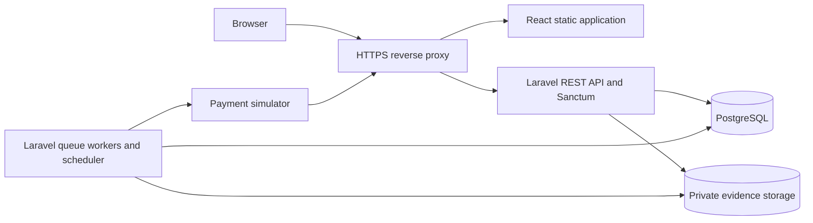

# Software architecture

Use a modular Laravel monolith and a separately built React single-page application. PostgreSQL is the system of record. The MVP uses simulated payment processing and settles debts only with verified Moul Hanout shops. The [business rules](business-rules.md) define when funds can move.

## Frontend

Build `frontend/` with React, TypeScript, and Vite. Place routing, session bootstrap, and locale initialization in `src/app/`. Organize case browsing, donations, beneficiary intake, shop operations, and administration in `src/features/`, with each feature owning its pages, components, API calls, and tests. Put reusable accessible primitives and layout components in `src/shared/ui/`, and Axios configuration, currency/date formatting, and cross-feature utilities in `src/shared/`.

React Router provides layouts and routes for public, donor, beneficiary, shopkeeper, and administrator views. Route guards guide navigation. Laravel enforces access. Use React Hook Form and Zod for form feedback, and map Laravel field errors into the form. Use a shared Axios instance for session cookies, CSRF, and error handling. Keep financial mutations explicit, attach a stable idempotency key to retries, and refresh server state after a mutation. Render monetary strings using exact arithmetic and locale-aware formatting.

Use Tailwind CSS and CSS logical properties. Keep French and Arabic strings in locale catalogs. Set the document's `lang` and `dir` on locale changes and test tab order, forms, tables, and mixed-direction amounts and references. Format dates for the selected Moroccan locale using `Africa/Casablanca` where local time is needed. Display plain dates such as debt origination dates without timezone conversion.

## Backend

Build `backend/` using Laravel conventions and the latest stable Laravel release compatible with the PHP runtime selected during foundation work. Pin and verify the eventual runtime and dependencies there. Organize models, Form Requests, Policies, API Resources, jobs, and service classes by their responsibilities. Domain services own case verification, eligibility, scoring, donation confirmation, allocation, settlement, and reconciliation. Controllers validate and authorize requests, call services, and return Resources. Services enforce state transitions and transaction invariants even when invoked by jobs. Use structured DTOs for commands and normalized payment events.

Deploy the SPA and API behind one origin while keeping their builds separate. Route API, Sanctum, and Laravel authentication routes, including login, logout, email verification, and password reset, to Laravel before applying the SPA fallback. Use Sanctum session authentication and CSRF for the browser. [Laravel Sanctum documentation](https://laravel.com/framework/docs/sanctum)

## Transactions and asynchronous work

Commit state transitions, financial events, audit decisions, and outbox jobs together. Workers process committed jobs at least once. Use deterministic keys per operation, retry database conflicts with bounded backoff, and retain failed work for operator review. Reconciliation compares the financial journal with simulator records and rebuilds or checks projections. UTC timestamps and correlation IDs connect requests, jobs, and evidence.

Use an adapter for the simulator's payment confirmation, refund, and shop payout operations. Send external commands only after their durable operation records commit. Treat an ambiguous response as pending reconciliation. Use a stable operation reference and retry external submission only when the adapter guarantees deduplication or reconciliation proves no prior submission. Authenticate and durably capture callbacks before acknowledging them.

Before dispatching a payout or refund, claim the requested operation under the financial lock, recheck approval, hold, freeze state, and applicable eligibility, then commit the transition to `submitted`. This commit is the cancellation cutoff. A crash after commit leaves the operation potentially in flight. Reconcile using the same operation reference. Later pauses and freezes block new claims.

## Risks and limitations

A single financial lock simplifies correctness and limits write throughput. Keep transactions short, bound allocation batches, and measure lock contention before changing the design. Private object storage and the database require coordinated backup and restore exercises. Duplicate events, late confirmations, and settlement failures are normal test scenarios. Live processing depends on approval of the legal structure and payment provider, and on verifying the provider's integration behavior.

See the [database design](database-design.md), [API contract](api-documentation.md), and [security design](security.md).
