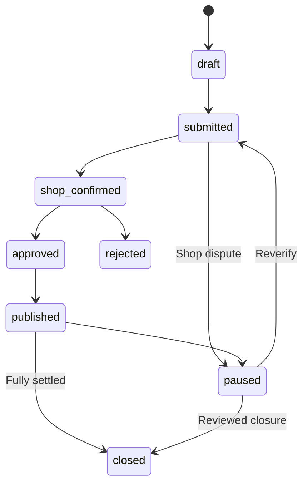

# Business rules

## Case verification and publication

A beneficiary submits their own case with evidence. An active member of the named shop confirms the debt reference, date, and eligible unpaid grocery balance. An administrator reviews the evidence and shop's verified status, sets the approved cap, records the decision, and reviews the redacted summary before publishing. A rejection requires a human decision and reason. Shop disputes pause intake for review.

Only published cases at verified shops with positive capacity receive allocations. Published cases with zero capacity can show funding or settlement progress. A pause blocks new allocations and payout submission, while already submitted operations must be reconciled. A verified shop suspension has the same effect for its cases. If an external debt payment or correction changes the cap, pause, reconcile in-flight payments, and release unspent allocations as needed before applying the new cap. If the proposed cap falls below the settled amount, open a reconciliation case and preserve the original settlement record. Record all decisions and reasons. Close a fully settled case after confirmed shop payments reach the cap. Reviewed closure releases remaining unspent funding subject to pending payout reconciliation.

## Donation and allocation

An authenticated donor creates a specific-case or urgent-pool intention. Check a specific case's eligibility and amount against its current capacity when accepting the intent. Intent creation holds no case capacity. A verified confirmation creates a cash receipt. Verify identity, currency, expected amount, and external reference before applying funding. Route discrepancies to reconciliation. A genuine late capture remains a financial receipt even after checkout expiry. Show confirmed and allocated amounts separately.

Process each distinct confirmed receipt once per allocation run. The designated funding receipt funds at most the intent amount. Account for additional captures and queue them for refund. In the simulated MVP, allocate specific-case funds only to the designated case, up to remaining capacity. Queue all excess for refund to the original payment method, including the full receipt if the case is no longer eligible. Queue any later release of specific-case funds for refund as well. Publish the versioned policy in French and Arabic before simulated checkout and preserve the disclosed version on the intent. Never divert specific funds into the pool.

For the urgent pool, select eligible cases in score order and allocate the lesser of remaining receipt funding and current case capacity. Retry on eligible-capacity changes and scheduled runs. Service unallocated receipts in confirmation order with receipt UUID as tie-breaker. The simulated MVP holding period is **30 × 24 hours from receipt confirmation**, measured in UTC. Under the financial lock, compare the current time to that deadline before allocating. At or after the deadline, stop allocating from that receipt and queue the unallocated balance for refund to the original payment method. Existing allocations stay in place. If an allocation is later released, use the original deadline and queue it for refund if the deadline has passed. The deadline ends allocation eligibility even if a freeze delays refund processing. Notify the donor when the refund is queued and when it is confirmed. Record the ordered inputs and allocations for each bounded run. Use a new run key for later decisions and resume through durable jobs.

## Urgency scoring

Only cases already eligible by human review enter the queue. Use the following normalization thresholds as the confirmed simulated MVP baseline and publish them as a versioned policy. Store the actor and rationale for assessed grades. Review cases missing essential assessments manually and make the queue delay visible to operators.

| Component | Weight | Proposed normalization to 0–10,000 |
| --- | --- | --- |
| Household vulnerability | 35% | Human-reviewed grade 0–4 multiplied by 2,500. Grade 0 means no documented vulnerability indicators, 1 mild, 2 moderate, 3 substantial, 4 severe. The review rubric considers verified dependents, income instability, and essential care burdens. |
| Debt age | 25% | Floor of 10,000 times elapsed whole local calendar days divided by 365, clamped to 0–10,000. Use the confirmed debt date and the run's local date. |
| Risk of losing access to basic groceries | 25% | Human-reviewed grade 0–4 multiplied by 2,500. Grade 0 means access is stable, 1 early warning, 2 credible restriction, 3 imminent cutoff, 4 essential access already interrupted. |
| Remaining amount | 15% | Floor of 10,000 times current allocatable case capacity in minor units divided by 500,000, clamped to 0–10,000. The score saturates at MAD 5,000. |

Sort by descending integer weighted sum of component points multiplied by their whole-number percentage weights. This compares scores exactly before display rounding. Break ties by older debt date, then earlier first publication timestamp, then ascending case UUID. Freeze scoring inputs for each bounded run and subtract capacity as allocations commit. Later runs rescore using current data. Policies require four nonnegative integer weights totaling 100 and positive normalization caps. Record every version and its effective time. Priority is a scheduling decision. A score cannot automatically reject an applicant. Review score distributions, waiting times, and regional coverage for evidence of bias or starvation.

## Shop payments, refunds, and reversals

Claiming an outgoing operation for dispatch changes its status to `submitted` under the financial lock. After that point, resolve it by reconciliation even if transmission has yet to be verified. Only operations that have never been claimed can be canceled and have their holds released through the pre-submission cancellation flow.

A settlement operator requests a payout for one case using eligible allocation lines. A distinct authorized administrator approves it before submission. Recheck case eligibility, shop verification, and the immutable destination snapshot. Cancel and recreate an unsubmitted payout after destination changes. An approved request remains `requested` until its submission is recorded. It can then reach `submitted` or `unknown` while pending a definitive outcome. Reserve funds in PostgreSQL before submission. Record a verified transfer immediately. If its private evidence is unavailable, mark it `evidence_pending` and route it to reconciliation. A payout reaches `paid` only once the evidence is available. A conclusive failure or pre-submission cancellation releases the hold. An ambiguous operation retains its hold. Only evidenced payouts count as settled donor impact.

Reserve unspent receipt funding before submitting a voluntary refund. If required by the applicable policy, first release unreserved and unspent allocation capacity. Funds reserved for payout or already transferred are ineligible for voluntary returns. A failed refund releases its hold and remains visible for review. Confirmed returns link to the original capture and preserve their reasons, amount, and external references.

Record verified forced reversals immediately. When a reversal creates a funding deficit, freeze new outgoing activity, cancel affected unsubmitted holds, and release eligible allocations up to the shortfall. Reconcile any submitted or unknown payout or refund before releasing its hold. Leave confirmed shop payments intact and keep any remaining receipt shortfall visible as a reconciliation exception. A freeze can clear only after reviewed reconciliation shows enough cash to cover all remaining obligations and affected receipts are excluded from new allocations while deficient. If cash coverage cannot be restored within the approved model, the freeze remains. A shop clawback or external recapitalization needs a separately approved workflow.

Concurrent confirmations can produce refundable excess. Provider delays can block settlement. Publish the limits of funding status and explain that a fully allocated case may still be awaiting shop payment. See the [financial journal and locking rules](database-design.md).
