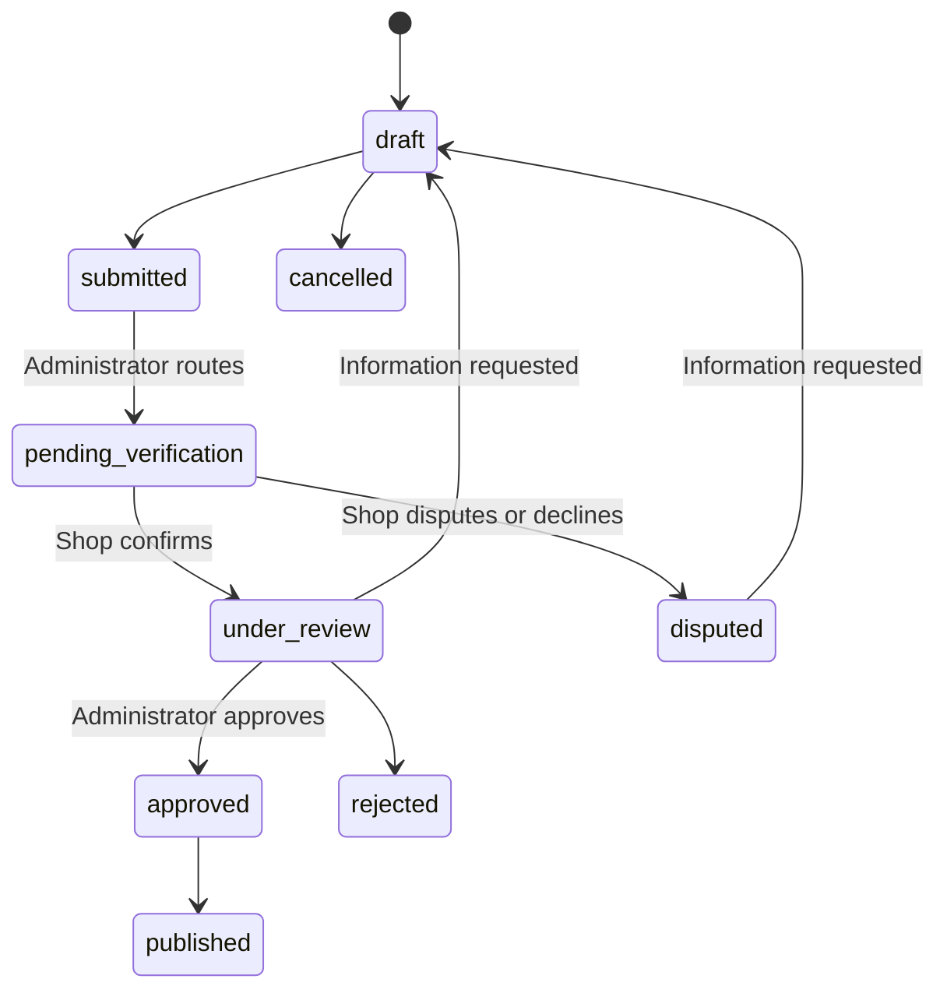

# Business rules

## Shop registration and verification inbox

A signed-in shopkeeper can manage their own shop and its evidence, assigned debt requests, and eligible settlement actions before email verification. Shop ownership and shop approval rules still apply. An administrator reviews the current profile revision and its scanned supporting evidence. An owner edit restarts review, and uploading new evidence can resubmit a rejected profile. A suspension prevents debt decisions until the shop is verified again.

An administrator can send a verified shop a debt reference and an exact amount in MAD minor units. Only the assigned owner's active account can confirm that amount or dispute it with a reason. Each request has one final response and is recorded separately from future case publication and settlement.

## Case verification and publication

A signed-in beneficiary can prepare and view their own draft, attach or download their own evidence, and submit their own application before confirming their email. A pending shop may be selected in a draft for its city. Submission requires an approved shop, an attachment for the current revision, and affirmative acceptance of the versioned consent terms. An attachment awaiting scanning is sufficient for submission. A rejected attachment does not qualify. An administrator routes the submitted case to the verified shop. Its assigned owner confirms the exact submitted amount or disputes or declines with a reason. A beneficiary cannot verify or administratively act on their own application, even with another role. Shopkeepers can add separate supporting documents.

An administrator can request information, reject with a reason, or flag a submitted, pending, disputed, under-review, or approved case. Requesting information returns it to a private draft and invalidates the prior consent, evidence revision, and verification. A beneficiary can cancel a draft, submitted, pending, under-review, or disputed case. A flagged case cannot be approved or published until the flag is cleared with a reason. Approval sets the cap to the confirmed amount and requires the same verified shop revision. Publication is a separate decision with the same checks. Only one approval or publication may exist for a normalized reference at a shop. Other duplicate indicators are for human review. A changed or suspended shop drops its published case from the public catalog.

Only published cases at verified shops with positive capacity receive allocations. Published cases with zero capacity can show funding or settlement progress. A pause blocks new allocations and payout submission, while already submitted operations must be reconciled. A verified shop suspension has the same effect for its cases. If an external debt payment or correction changes the cap, pause, reconcile in-flight payments, and release unspent allocations as needed before applying the new cap. If the proposed cap falls below the settled amount, open a reconciliation case and preserve the original settlement record. Record all decisions and reasons. Close a fully settled case after confirmed shop payments reach the cap. Reviewed closure releases remaining unspent funding subject to pending payout reconciliation.

## Donation and allocation

A donor can record a WhatsApp pledge for a specific published case after declaring that they sent the message. It is an unpaid intent. It neither reserves case capacity nor creates a receipt or allocation. WhatsApp click-to-chat supplies no delivery confirmation. Only the existing confirmed-payment workflow can allocate funds. Production accepts pledges while simulated confirmation remains disabled.

The owner of the verified shop can confirm one external receipt per WhatsApp pledge with the paid amount, a unique shop payment reference and private evidence. Confirmation immediately credits the verified debt under the financial lock, preserving the original public debt amount and refusing any reduction that would strand existing allocations. The actor and amount are audited. The external credit is tracked separately from platform receipts, allocations and payout statistics. A confirmed external receipt cannot also be confirmed through the simulator. The administrative review controls remain available for declarations that were already pending when the direct confirmation workflow was introduced.

Phase 6 runs these operations only in explicit local and testing simulation. Intent and payment states are separate from allocation state. A payment failure or cancellation creates no receipt. A later signed confirmation can still create the single receipt once. Pending and confirmed returns are shown in the donor detail view. Shop payout dispatch and external reconciliation remain outside this phase.

A signed-in donor can view their own donation history, create a specific-case or urgent-pool intention, and complete simulated checkout before confirming their email. Check a specific case's eligibility and amount against its current capacity when accepting the intent. Intent creation holds no case capacity. A verified confirmation creates a cash receipt. Verify identity, currency, expected amount, and external reference before applying funding. Route discrepancies to reconciliation. A genuine late capture remains a financial receipt even after checkout expiry. Show confirmed and allocated amounts separately.

Process each distinct confirmed receipt once per allocation run. The designated funding receipt funds at most the intent amount. Account for additional captures and queue them for refund. In the simulated MVP, allocate specific-case funds only to the designated case, up to remaining capacity. Queue all excess for refund to the original payment method, including the full receipt if the case is no longer eligible. Queue any later release of specific-case funds for refund as well. Publish the versioned policy in French and Arabic before simulated checkout and preserve the disclosed version on the intent. Never divert specific funds into the pool.

For the urgent pool, select eligible cases in score order and allocate the lesser of remaining receipt funding and current case capacity. Retry on eligible-capacity changes and scheduled runs. Service unallocated receipts in confirmation order with receipt UUID as tie-breaker. The simulated MVP holding period is **30 × 24 hours from receipt confirmation**, measured in UTC. Under the financial lock, compare the current time to that deadline before allocating. At or after the deadline, stop allocating from that receipt and queue the unallocated balance for refund to the original payment method. Existing allocations stay in place. If an allocation is later released, use the original deadline and queue it for refund if the deadline has passed. The deadline ends allocation eligibility even if a freeze delays refund processing. Notify the donor when the refund is queued and when it is confirmed. Record the ordered inputs and allocations for each bounded run. Use a new run key for later decisions and resume through durable jobs.

## Urgency scoring

Phase 5 enables donor discovery using `config/discovery.php`. Open cases with both current reviewer grades and a score of at least 60/100 are urgent by default. The threshold, weights, and normalization caps are configurable. Published cases without grades remain discoverable in the general catalog. Public story templates are selected by reviewers. Internal descriptions, grades, and review reasons stay private.

Homepage statistics come from settlement, allocation, and confirmed receipt reporting projections. Families helped counts distinct beneficiary profiles with an evidenced settlement greater than zero. Historical impact is independent of whether a case is still listed publicly. Unfunded cases have zero funding progress and remain open. Fully allocated cases are funded, and cases fully settled with the shop are settled.

Only cases already eligible by human review enter the queue. Use the following normalization thresholds as the confirmed simulated MVP baseline and publish them as a versioned policy. Store the actor and rationale for assessed grades. Review cases missing essential assessments manually and make the queue delay visible to operators.

| Component | Weight | Proposed normalization to 0–10,000 |
| --- | --- | --- |
| Household vulnerability | 35% | Human-reviewed grade 0–4 multiplied by 2,500. Grade 0 means no documented vulnerability indicators, 1 mild, 2 moderate, 3 substantial, 4 severe. The review rubric considers verified dependents, income instability, and essential care burdens. |
| Debt age | 25% | Floor of 10,000 times elapsed whole local calendar days divided by 365, clamped to 0–10,000. Use the confirmed debt date and the run's local date. |
| Risk of losing access to basic groceries | 25% | Human-reviewed grade 0–4 multiplied by 2,500. Grade 0 means access is stable, 1 early warning, 2 credible restriction, 3 imminent cutoff, 4 essential access already interrupted. |
| Remaining amount | 15% | Floor of 10,000 times current allocatable case capacity in minor units divided by 500,000, clamped to 0–10,000. The score saturates at MAD 5,000. |

Sort by descending integer weighted sum of component points multiplied by their whole-number percentage weights. This compares scores exactly before display rounding. Break ties by older debt date, then earlier first publication timestamp, then ascending case UUID. Freeze scoring inputs for each bounded run and subtract capacity as allocations commit. Later runs rescore using current data. Policies require four nonnegative integer weights totaling 100 and positive normalization caps. Record every version and its effective time. Priority is a scheduling decision. A score cannot automatically reject an applicant. Review score distributions, waiting times, and regional coverage for evidence of bias or starvation.

## Shop payments, refunds, and reversals

Claiming an outgoing operation for dispatch changes its status to `submitted` under the financial lock. After that point, resolve it by reconciliation even if transmission has yet to be verified. Only operations that have never been claimed can be canceled and have their holds released through the pre-submission cancellation flow.

A settlement operator requests a payout for one case using eligible allocation lines. A distinct authorized administrator approves it before submission. Recheck case eligibility, shop verification, and the immutable destination snapshot. Cancel and recreate an unsubmitted payout after destination changes. An approved request remains `requested` until its submission is recorded. It can then reach `submitted` or `unknown` while pending a definitive outcome. Reserve funds in PostgreSQL before submission. Record a verified transfer immediately. If its private evidence is unavailable, mark it `evidence_pending` and route it to reconciliation. A payout reaches `paid` only once the evidence is available. A conclusive failure or pre-submission cancellation releases the hold. An ambiguous operation retains its hold. Only evidenced payouts count as settled donor impact.

Reserve unspent receipt funding before submitting a voluntary refund. If required by the applicable policy, first release unreserved and unspent allocation capacity. Funds reserved for payout or already transferred are ineligible for voluntary returns. A failed refund releases its hold and remains visible for review. Confirmed returns link to the original capture and preserve their reasons, amount, and external references.

Record verified forced reversals immediately. When a reversal creates a funding deficit, freeze new outgoing activity, cancel affected unsubmitted holds, and release eligible allocations up to the shortfall. Reconcile any submitted or unknown payout or refund before releasing its hold. For an unsubmitted simulated refund, cancel only the amount needed for the reversal. If part of the refund remains due, record the release of the original hold and reserve the remainder under the original reason. A partially reversed pool receipt stays eligible for allocation or expiry while it has available funds. Leave confirmed shop payments intact and keep any remaining receipt shortfall visible as a reconciliation exception. A freeze can clear only after reviewed reconciliation shows enough cash to cover all remaining obligations and affected receipts are excluded from new allocations while deficient. If cash coverage cannot be restored within the approved model, the freeze remains. A shop clawback or external recapitalization needs a separately approved workflow.

Concurrent confirmations can produce refundable excess. Provider delays can block settlement. Publish the limits of funding status and explain that a fully allocated case may still be awaiting shop payment. See the [financial journal and locking rules](database-design.md).

## Phase 7 simulated settlement

A fully allocated case enters the settlement queue. An administrator reserves the full allocation with an immutable set of funding lines. A second administrator rechecks eligibility and submits the recorded shop destination. The local simulator generates a unique reference and a private structured receipt. A recorded transfer appears separately from shop-confirmed receipt and reconciled settlement. A dispute retains the transfer history and blocks reconciliation until the shop resolves it by confirming receipt. Reconciliation checks the evidence, shop response and amount, then updates the public settlement projection in the same transaction.

Failed simulated transfers release their reservations and can be retried with a new attempt. A donor reversal can cancel an affected unsubmitted attempt. A submitted or recorded transfer stays held. If a submitted attempt conclusively fails, an administrator can review and release previously held capacity to cover receipt shortfalls. Recovery clears the freeze only after every receipt is covered. A shortfall against a transferred payout remains visible and requires a separately approved recovery process.

Public totals distinguish confirmed donations, net allocations, recorded transfers, shop-confirmed receipt, and reconciled debts. Available funds are the sum of positive unallocated receipt balances after confirmed returns and pending refund holds. Deficits are visible to administrators and never treated as spendable funds. Regional impact counts reconciled cases and distinct beneficiaries per region. Participating shops are currently verified shops.

## Campaign moderation

Unpublishing returns a campaign to approved status and clears its public listing. Suspension also flags the case, which blocks republishing until an administrator clears the flag. Existing funding and pending financial obligations remain recorded. A case with allocation history cannot be returned to draft or rejected through ordinary case review. Reopening a shop dispute sends the case to verification again at the verified shop. Every decision records the actor, prior and resulting state, and the required reason.
