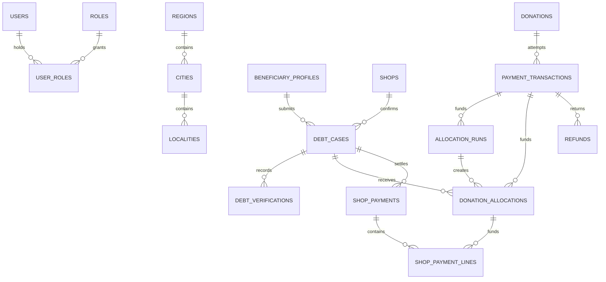

# Database design

Use PostgreSQL migrations for all schema changes. The model separates case evidence, donor intent, settled incoming money, allocation, shop settlement, and returns. Use generated UUID primary keys named `id` unless a different primary key is listed. FKs are required unless marked optional and use restrictive deletion. Create indexes on referencing FK columns where a declared index lacks that leading prefix. Business timestamps use `timestamptz` in UTC. Debt origination uses `date`. Money uses bounded `bigint` MAD minor units with positive checks for events and nonnegative checks for balances. Use `numeric` for intermediate aggregate arithmetic where needed. Use text with CHECK constraints for status values.

## Identity, geography, and verification

| Table | Columns, relationships, and constraints | Additional indexes |
| --- | --- | --- |
| `users` | Unique normalized email, password hash, locale `fr\|ar`, status `active\|suspended\|closed`, verification timestamps | Unique normalized email |
| `roles` | Unique role code seeded with `donor`, `beneficiary`, `shopkeeper`, `administrator` | Unique code |
| `user_roles` | Composite PK `(user_id, role_id)`, FKs to users and roles, grant timestamp | `(role_id, user_id)` |
| `admin_ability_grants` | Composite PK `(user_id, ability_code)`, user and grantor FKs, grant timestamp. Requires administrator role and a code from the application ability catalog. Audit revocations | `(ability_code, user_id)` |
| `regions` | Unique reference code and French and Arabic names. Seed all 12 regions | Unique code |
| `cities` | Region FK, reference code, French and Arabic names. Unique `(region_id, code)` | `(region_id, name_fr)` |
| `localities` | City FK, reference code, French and Arabic names. Unique `(city_id, code)` | `(city_id, name_fr)` |
| `beneficiary_profiles` | Unique user FK, locality FK, restricted household and contact fields, optional archive timestamp | Unique user FK |
| `shops` | Locality FK, display name, restricted settlement destination reference, status `pending\|verified\|suspended\|closed` | `(locality_id, status)` |
| `shop_memberships` | Composite PK `(shop_id, user_id)`, membership status `active\|revoked` | `(user_id, status)` |
| `debt_cases` | Beneficiary profile and shop FKs, debt date, unique normalized debt reference per shop, approved cap, approval/publication timestamps, status `draft\|submitted\|shop_confirmed\|approved\|published\|paused\|closed\|rejected`, redacted localized summaries, active allocation and settled balance projections | `(status, published_at, id)`, `(shop_id, status)`, `(beneficiary_profile_id, status)` |
| `debt_verifications` | Case and actor user FKs, immutable decision `shop_confirmed\|shop_disputed\|admin_approved\|admin_rejected\|admin_paused\|admin_revalidated`, reviewed balance and reason, timestamp | `(debt_case_id, created_at, id)` |
| `documents` | Uploader user FK, optional case FK, unique private storage key, media type, byte size, integrity digest, status `quarantined\|available\|rejected\|purged`, purpose `debt_evidence\|settlement_evidence`. Case FK required for debt evidence. Retain metadata and purge timestamp after authorized object disposal | `(debt_case_id, purpose, status)` |
| `verification_documents` | Composite PK `(verification_id, document_id)`. Both rows must reference the same case and evidence must be available at decision time | `(document_id, verification_id)` |
| `urgency_policies` | Unique version, effective timestamp, weights and normalization configuration, actor user FK. Immutable once published | `(effective_at, version)` |
| `case_assessments` | Case, assessor user and policy FKs, vulnerability and grocery risk grades, rationale, assessment timestamp. Append new assessments on revision | `(debt_case_id, created_at, id)` |

## Financial records

| Table | Columns, relationships, and constraints | Additional indexes |
| --- | --- | --- |
| `donation_policies` | Unique version, effective time, publisher user FK, French and Arabic disclosed text, pool holding period and disposition rules. Immutable after publication | `(effective_at, version)` |
| `donations` | Donor user FK, optional designated case FK, immutable FK to policy shown at checkout, intent amount, scope `specific\|urgent_pool`, status `pending\|confirmed\|expired`. CHECK requires case exactly for specific scope. Expiry is a checkout state and permits a later confirmed receipt | `(donor_id, created_at, id)`, `(status, created_at)` |
| `payment_transactions` | Donation FK, immutable expected amount, adapter and merchant scope, unique local operation key, optional external capture reference unique within adapter and merchant, confirmed amount and timestamp, status `pending\|failed\|confirmed`. One row per independently capturable attempt. Multiple confirmed attempts are recorded when they represent distinct receipts | `(donation_id, confirmed_at, id)`, `(status, updated_at)` |
| `allocation_runs` | Payment transaction FK for the single receipt being allocated, unique run key, optional urgency policy FK, decision timestamp, mode `specific\|urgent_pool`, immutable ordered decision snapshot with assessments, score components, capacities, and chosen amounts | `(payment_transaction_id, created_at)` |
| `donation_allocations` | Run, payment transaction, and case FKs, positive amount, immutable rank and optional score. Unique `(allocation_run_id, debt_case_id)`. Composite FK to guarantee run and allocation use the same receipt. Derive donation through receipt | `(debt_case_id, created_at)`, `(payment_transaction_id, created_at)` |
| `shop_payments` | Case FK, initiator and optional distinct approver user FKs, amount, immutable verified destination snapshot and unique operation key, optional external operation reference unique within adapter and merchant, optional evidence document FK required for `paid`, status `requested\|submitted\|unknown\|evidence_pending\|paid\|failed\|canceled`. Derive shop from case, freeze the shop relationship after submission | `(debt_case_id, status)`, `(status, updated_at)` |
| `shop_payment_lines` | Composite PK `(shop_payment_id, allocation_id)`, positive amount. Verify the allocation case equals the payout case and line sum equals payout amount | `(allocation_id, shop_payment_id)` |
| `refunds` | Incoming payment transaction FK, amount, kind `refund\|reversal`, reason, status `requested\|submitted\|unknown\|confirmed\|failed\|canceled`, unique operation key and optional scoped external return reference, optional requester user FK. Forced reversals enter as confirmed when verified | `(payment_transaction_id, status)`, `(status, updated_at)` |
| `financial_events` | Immutable event type, positive amount, timestamp, unique deterministic operation key, correlation ID, optional actor user FK. Nullable typed FKs to receipt, allocation, shop payment and refund with required combinations by event type. Optional link to original event for compensation | Index each source FK with event timestamp |
| `financial_control` | Singleton PK with CHECK requiring ID 1. Transaction lock and reason for a settlement freeze | PK |

Add a unique constraint on `allocation_runs (id, payment_transaction_id)` for the composite FK. Require allocations to reference a confirmed funding receipt and require the allocated case to match the designated case for specific donations. Mark the first matching capture accepted under the financial lock as the funding receipt. A partial unique index on donation ID permits only one such receipt per intention. Other confirmed captures remain recorded and are ineligible for allocation.

Bind settlement documents to a shop payment using a required FK for that purpose. Require the document's case to match the payment's case. A payout's evidence FK must reference an available settlement document bound to that payout when recording evidenced settlement. Verification document links accept only debt evidence.

Use the immutable `financial_events` journal as the operational financial record. Use these event types and references.

| Type | Required reference | Effect |
| --- | --- | --- |
| `receipt_confirmed` | Receipt | Adds confirmed cash and receipt funding |
| `allocation_created` | Allocation | Commits receipt funding to case capacity |
| `allocation_released` | Allocation and original event | Releases an unsettled, unreserved allocation amount |
| `payout_reserved` | Shop payment and its immutable funding lines | Holds allocations for one outgoing payment |
| `payout_released` | Shop payment and reserve event | Removes that hold after terminal failure or cancellation |
| `payout_transferred` | Shop payment and reserve event | Converts the hold to a spent amount and reduces cash on verified transfer |
| `payout_evidenced` | Shop payment and transfer event | Counts the transferred amount as evidenced settlement. No cash movement |
| `return_reserved` | Refund | Holds unused receipt funding for a voluntary return |
| `return_released` | Refund and reserve event | Frees a failed or canceled return hold |
| `return_confirmed` | Refund, and reserve event for voluntary refund | Reduces cash. Converts a voluntary hold or records a forced reversal immediately |

Journal and funding rows are insert-only for the runtime role. Protect them with privileges and defensive triggers. Partial unique indexes permit one receipt confirmation per receipt, one allocation creation per allocation, one reserve and one terminal hold outcome per outgoing operation, and one evidence completion per transfer. Monetary corrections use linked compensating events. Keep financial state changes and events in one PostgreSQL transaction.

## Operational records

| Table | Columns, relationships, and constraints | Additional indexes |
| --- | --- | --- |
| `webhook_events` | Unique `(adapter, merchant_scope, external_event_id)`, payload digest, restricted normalized payload or encrypted evidence pointer, processing status `received\|processed\|needs_review`, received and processed timestamps | `(status, received_at)` |
| `idempotency_keys` | Composite PK `(user_id, operation, key)`, request digest, stored outcome or resource reference, expiry where retries are time-bound. Retain durable financial operation references independently | `(expires_at)` |
| `outbox_jobs` | Unique operation key, job type, resource reference payload, status `pending\|running\|completed\|failed`, attempt count, available time and lease expiry | `(status, available_at)`, `(status, lease_expires_at)` |
| `notifications` | Recipient user FK, type, minimal payload, deduplication key unique per recipient, created/read timestamps | `(user_id, read_at, created_at)` |
| `audit_logs` | Append-only actor user FK if human, actor kind, action, target type and UUID, time, correlation ID, redacted metadata. Target is a historical reference | `(target_type, target_id, created_at)`, `(actor_id, created_at)` |

## Locking and reconciliation

Use PostgreSQL Read Committed. In every financial mutation, and every case or shop mutation affecting eligibility or capacity, acquire `financial_control` using `FOR UPDATE` first. Lock affected receipt, donation, case, and operation rows in a fixed table order and ascending UUID order within each table. Re-read eligibility and balances under the lock. Scoring inputs and policy publication that change eligibility or ranking use the same protocol. Keep network I/O outside the transaction. Protected service writes and database triggers or deferred constraint triggers enforce cross-row invariants. Use row CHECKs for local invariants only. [PostgreSQL row locks](https://www.postgresql.org/docs/current/explicit-locking.html) · [PostgreSQL constraints](https://www.postgresql.org/docs/current/ddl-constraints.html)

- Case usage equals allocation creations minus releases, including money reserved or paid to its shop. Require usage at most the approved cap, and settled amount at most usage. Available case capacity equals cap minus usage.
- For a receipt, allocatable funding equals received cash minus confirmed returns, open voluntary return holds, and net allocations. Check that new allocations and voluntary return reservations leave it nonnegative. A verified forced reversal may make this balance negative. Record it, freeze new outgoing activity, and reconcile under the [reversal rules](business-rules.md#shop-payments-refunds-and-reversals).
- For an allocation, net allocation minus reserved and transferred shop lines is available to release or reserve for settlement. A transfer awaiting evidence still consumes funding. Require that result to stay nonnegative. Require total confirmed returns per receipt to stay within confirmed receipt value. Quarantine conflicting provider data and reconcile.
- Rebuild projections from the journal. Reconcile cash as receipts less confirmed payouts and returns, track pending holds separately, and compare against simulator cash movements. Investigate discrepancies before resuming outgoing operations. An accounting or provider reporting integration may require a separate general ledger.

Close or archive referenced users, shops, and profiles in place. Deactivate geography references without deleting rows in use. Keep verification decisions, case history, and financial records. Apply approved retention and personal data minimization through field redaction or object purge with audit events. Access controls and backups must cover the journal as well as operational data. See the [business rules](business-rules.md) for edge cases and the [security design](security.md) for evidence handling.
